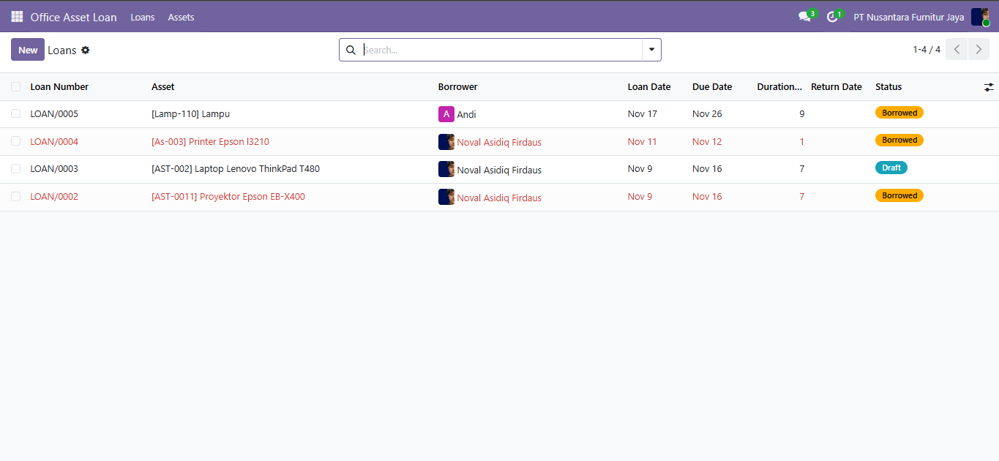
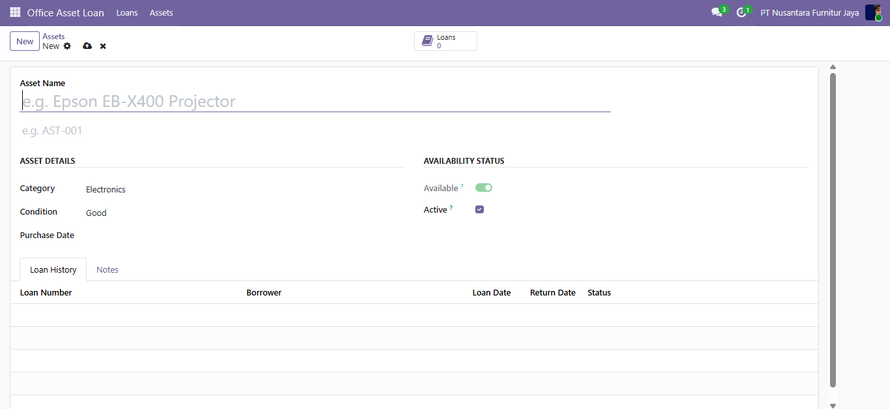
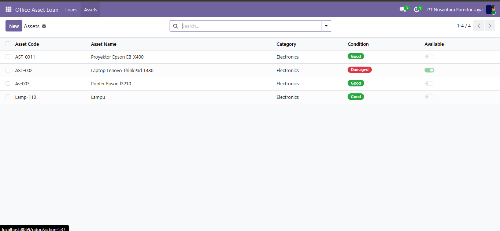
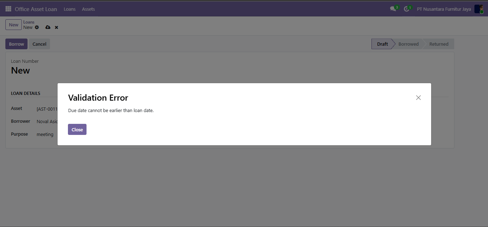
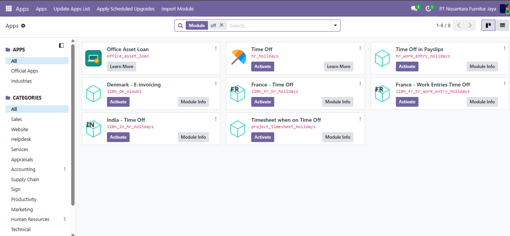

# Office Asset Loan (`office_asset_loan`)

> **Tugas Odoo Bootcamp Batch #10 (Basic): Custom Module “Office Asset Loan”**
> **Versi Odoo: Community Edition (CE) 19.0**

---

## 1. Deskripsi Modul

Modul `office_asset_loan` mencatat inventaris bersama kantor (proyektor, laptop cadangan, kamera, kabel roll, dsb.) dan mengelola siklus peminjamannya secara transparan, akurat, dan terstruktur.

Dengan modul ini:

- Setiap aset memiliki kode unik dan status ketersediaan (_Available_).
- Peminjaman ganda (_double borrowing_) pada aset yang sedang dipinjam dicegah.
- Aset berkondisi rusak (_Damaged_) tidak dapat dipinjam.
- Durasi peminjaman dihitung dan keterlambatan pengembalian (_overdue_) terdeteksi otomatis.
- Peminjaman berstatus _Borrowed_ atau _Returned_ tidak dapat dihapus.

---

## 2. Daftar Fitur

### 2.1 Master Inventaris Kantor (`office.asset`)

- Data aset: Nama Aset, Kode Aset, Kategori (_Electronics, Furniture, Vehicle, Other_), Tanggal Beli, Kondisi (_Good, Fair, Damaged_), Catatan, dan Status Aktif (mendukung _archive_).
- **BR-1** – Kode aset unik di tingkat database melalui `models.Constraint('UNIQUE(code)', ...)`.
- **Ketersediaan real-time** – kolom `is_available` bernilai _True_ bila tidak ada peminjaman berstatus _Borrowed_.
- **Smart button “Loans”** – menampilkan jumlah peminjaman dan membuka daftar peminjaman aset terkait.
- Tab **Loan History** pada form aset.

### 2.2 Pencatatan Peminjaman (`office.asset.loan`)

| Kode     | Aturan bisnis                                                                                                             |
| -------- | ------------------------------------------------------------------------------------------------------------------------- |
| **BR-2** | `due_date` tidak boleh lebih awal dari `loan_date` (`@api.constrains`).                                                   |
| **BR-3** | Nomor peminjaman otomatis `LOAN/0001`, `LOAN/0002`, dst. (`ir.sequence` + `@api.model_create_multi`).                     |
| **BR-4** | Tombol **Borrow** hanya untuk status _Draft_; aset tidak boleh sedang dipinjam pihak lain dan kondisinya bukan _Damaged_. |
| **BR-5** | Tombol **Return** hanya untuk status _Borrowed_; mengisi `return_date` hari ini dan mengubah status menjadi _Returned_.   |
| **BR-6** | Tombol **Cancel** membatalkan peminjaman berstatus _Draft_.                                                               |
| **BR-7** | Peminjaman _Borrowed_ atau _Returned_ tidak boleh dihapus (`@api.ondelete(at_uninstall=False)`).                          |
| **BR-8** | `due_date` otomatis diisi `loan_date` + 7 hari saat `loan_date` diubah, jika `due_date` kosong atau lebih awal.           |

Tambahan:

- **Durasi & Overdue** – `duration_days` menghitung selisih hari, dan baris yang terlambat (`is_overdue`) ditandai merah (`decoration-danger`).
- **Filter Overdue** pada pencarian peminjaman.

### 2.3 Keamanan dan Data Demo

- **Record Rule** – pengguna internal hanya melihat peminjamannya sendiri, Administrator melihat seluruh peminjaman.
- **Data demo** pada `demo/office_asset_loan_demo.xml` (4 aset dan 3 peminjaman).

---

## 3. Screenshot

### 3.1 Daftar Peminjaman (Loans)

Baris berwarna merah adalah peminjaman yang melewati tenggat (_overdue_).



### 3.2 Form Peminjaman Berstatus _Borrowed_


### 3.3 Form Aset

Terdapat smart button **Loans**, status ketersediaan, serta tab **Loan History**.



### 3.4 Tambahan

**Daftar aset** (kolom Condition dan Available):



**Validasi BR-2** – tenggat tidak boleh lebih awal dari tanggal pinjam:



**Modul pada menu Apps:**



---

## 4. Cara Instalasi

**Persyaratan:** Odoo Community Edition **19.0** dan PostgreSQL.

### Metode 1: Melalui Antarmuka Odoo (UI)

1. Letakkan folder `office_asset_loan` di direktori `custom-addons` yang terdaftar pada `addons_path` di `odoo.conf`:
   ```ini
   addons_path = C:\odoo-dev\odoo\odoo\addons,C:\odoo-dev\odoo\addons,C:\odoo-dev\custom-addons
   ```
2. Restart Odoo Server (di VS Code tekan `F5` atau tombol Restart).
3. Buka `http://localhost:8069`.
4. Aktifkan **Developer Mode** (menu _Settings_, atau tambahkan `?debug=1` pada URL).
5. Buka menu **Apps** → **Update Apps List** → **Update**.
6. Hapus filter pada kotak pencarian, lalu ketik `Office Asset Loan`.
7. Klik **Activate** / **Install**.

### Metode 2: Melalui Terminal (CLI)

```powershell
& "C:\odoo-dev\odoo\.venv\Scripts\python.exe" "C:\odoo-dev\odoo\odoo-bin" -c "C:\odoo-dev\odoo\odoo.conf" -d <nama_database> -i office_asset_loan
```

Untuk memperbarui modul setelah ada perubahan kode, ganti `-i` dengan `-u`.

---

## 5. Cara Penggunaan Singkat

1. Buka menu **Office Asset Loan → Assets**, lalu buat aset (nama, kode unik, kategori, kondisi).
2. Buka **Loans → New**, pilih aset dan peminjam, lalu isi tanggal pinjam dan tujuan. Tenggat terisi otomatis 7 hari.
3. Klik **Borrow** agar status menjadi _Borrowed_. Aset otomatis tidak _Available_.
4. Setelah aset kembali, klik **Return**. Status menjadi _Returned_ dan aset kembali _Available_.

---

## 6. Struktur Berkas Modul

```
office_asset_loan/
├── __init__.py
├── __manifest__.py
├── README.md
├── screenshots/
├── models/
│   ├── __init__.py
│   ├── office_asset.py
│   └── office_asset_loan.py
├── security/
│   ├── ir.model.access.csv
│   └── office_asset_security.xml
├── data/
│   └── office_asset_loan_sequence.xml
├── demo/
│   └── office_asset_loan_demo.xml
├── views/
│   ├── office_asset_views.xml
│   ├── office_asset_loan_views.xml
│   └── office_asset_menus.xml
└── static/description/
    └── icon.png
```

---

## 7. Verifikasi Skenario Uji (12 Skenario)

| #   | Langkah Pengujian                                  | Hasil                                                                 | Status |
| --- | -------------------------------------------------- | --------------------------------------------------------------------- | :----: |
| 1   | Install modul pada database baru                   | Terinstal bersih tanpa error dan warning                              |   ✅   |
| 2   | Buat aset “Proyektor Epson”, kode `AST-001`        | Tersimpan, status _Available_                                         |   ✅   |
| 3   | Buat aset kedua dengan kode `AST-001`              | Ditolak constraint PostgreSQL (BR-1)                                  |   ✅   |
| 4   | Buat peminjaman baru, pilih Proyektor Epson        | `LOAN/0001` terbentuk, peminjam = user login, tanggal pinjam hari ini |   ✅   |
| 5   | Ubah `due_date` menjadi kemarin, simpan            | `ValidationError` (BR-2)                                              |   ✅   |
| 6   | Perbaiki `due_date`, klik Borrow                   | Status _Borrowed_, form read-only, aset tidak _Available_             |   ✅   |
| 7   | Peminjaman kedua untuk aset yang sama, klik Borrow | `UserError`, aset sedang dipinjam (BR-4)                              |   ✅   |
| 8   | Hapus peminjaman berstatus _Borrowed_              | `UserError` (BR-7)                                                    |   ✅   |
| 9   | Klik Return pada peminjaman pertama                | Status _Returned_, `return_date` hari ini, aset _Available_           |   ✅   |
| 10  | Ubah kondisi aset menjadi Damaged, coba Borrow     | `UserError`, kondisi Damaged (BR-4)                                   |   ✅   |
| 11  | Buka tab Loan History pada form aset               | Seluruh riwayat tampil                                                |   ✅   |
| 12  | Login sebagai user internal biasa                  | Menu tampil normal, ACL dan Record Rule bekerja                       |   ✅   |

---

## 8. Kepatuhan Odoo 19 Community Edition

- Memakai `<list>` dan `view_mode="list,form"` (tanpa `<tree>`).
- Ekspresi Python langsung pada `invisible="..."` dan `readonly="..."` (tanpa `attrs`).
- Memakai `models.Constraint(...)` (tanpa `_sql_constraints`).
- Memakai `@api.model_create_multi` dengan `vals_list` pada `create()`.
- Memakai `@api.ondelete(at_uninstall=False)` untuk proteksi integritas data.
- Memakai `self.env.cr`, `self.env.uid`, dan `self.env.context` (tanpa atribut privat usang).
- Skema XML Search View mematuhi validasi RelaxNG Odoo 19.
